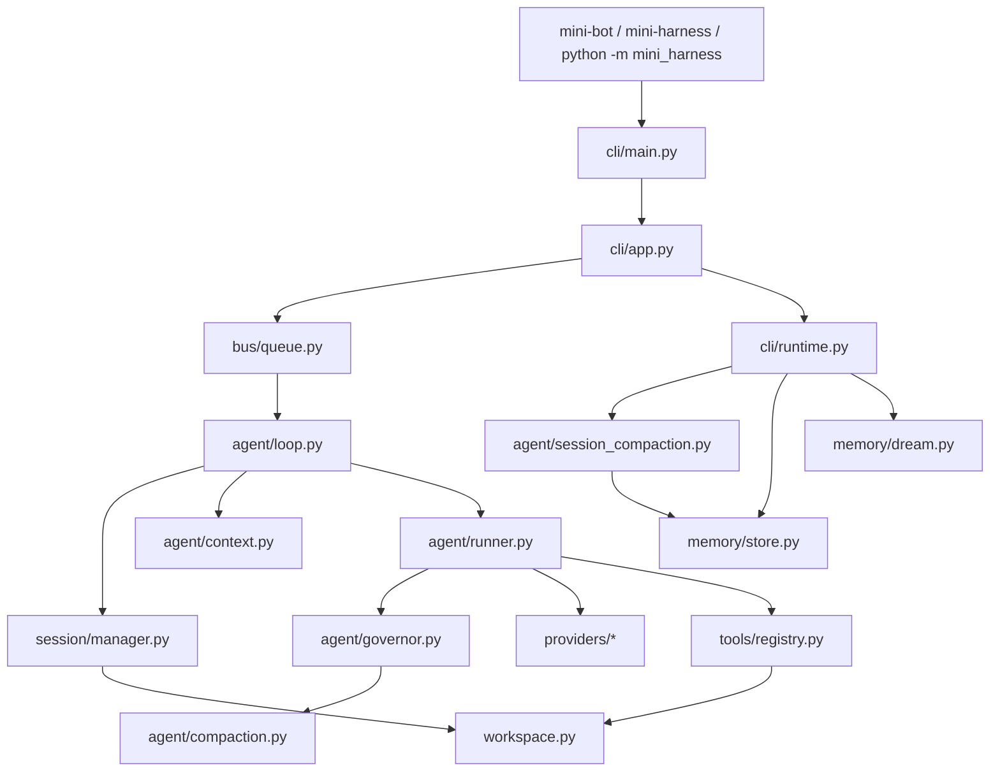

# Mini Harness 架构总览

> 适用版本：Mini Harness V2.2（包版本 `0.3.0`）
> 代码快照：`uv run pytest -q` → **451 passed**
> 本文只描述当前实现，不包含规划中的能力；规划项见 [V3 建议](../README.md#后续建议v3不在本次实现)。

## 1. 定位与设计取舍

Mini Harness 是一个可运行、可测试的最小 Agent Harness，用来观察真实 Harness 的分层，
而不是尽可能多地堆功能。由此产生四条明确的取舍：

| 取舍 | 结果 |
| --- | --- |
| 不依赖 Agent 框架 | 只有 `asyncio` + `httpx`；循环、预算、摘要全部自己实现 |
| 不使用数据库 | Session 用单文件 JSON + 原子替换；`flock` 限制单实例 |
| 单 Channel、单默认 Session | 一个 Workspace 对应一份 `cli:main` 历史，不做会话切换 |
| Token 用估算而非 tokenizer | 不绑定具体模型，预算偏保守，明确承认误差 |

## 2. 分层结构



| 层 | 模块 | 职责 | 明确不负责 |
| --- | --- | --- | --- |
| 入口 | `cli/main.py`、`__main__.py` | 参数解析、安装入口、离线 `--demo` | 会话状态 |
| 交互 | `cli/app.py`、`console.py`、`settings.py`、`runtime.py`、`profiles.py` | 读输入、渲染流式输出、`/` 命令、Provider 选择与维护任务生命周期 | 直接改 Session 文件 |
| 总线 | `bus/events.py`、`bus/queue.py` | `InboundMessage` / `OutboundMessage` 的 FIFO 传递 | 任何业务判断 |
| 调度 | `agent/loop.py` | 跨轮次状态：加载 → 构建 → 运行 → 保存 | 单轮迭代与工具执行 |
| 上下文 | `agent/context.py`、`context_types.py`、`tokens.py`、`messages.py`、`transcript.py` | System Prompt、AGENTS.md、历史选择、预算公式与消息协议 | 持久化、调用 Provider |
| 治理 | `agent/governor.py`、`compaction.py`、`session_compaction.py`、`maintenance.py` | 每次请求的预算检查、摘要、持久化 Checkpoint、空闲触发 | 修改 Provider 协议 |
| 执行 | `agent/runner.py` | 模型 → 工具 → 模型的有限轮迭代 | Session、Memory、CLI |
| Provider | `providers/` | 协议转换、流式聚合、重试 | 上下文裁剪 |
| 工具 | `tools/` | Schema、参数校验、受限执行、文件读写 | 决定何时调用 |
| 持久化 | `session/manager.py`、`migration.py` | schema v2 严格加载、原子保存、锁、显式迁移 | 摘要生成 |
| 记忆 | `memory/store.py`、`document.py`、`dream.py`、`scheduler.py` | 长期记忆文件、归档、Dream 整理 | 保存原始对话 |
| 边界 | `workspace.py` | 路径解析、越界检查、稳定 `workspace_id` | 实际文件权限隔离 |

## 3. 依赖方向

实测的导入关系（`grep` 全包交叉引用）：

```text
prompts   → (无内部依赖)
bus       → (无内部依赖)
providers → (仅包内 config/base/retry)
workspace → (无内部依赖)
tools     → workspace
session   → workspace
memory    → providers.base        # 仅用 LLMProvider 类型
agent     → bus, memory, prompts, providers, tools, session, workspace
cli       → agent, bus, providers, tools, workspace, memory
```

约束：

- 下层不反向导入上层；`tools` 不知道 `agent`，`providers` 不知道 `agent`。
- 只有 `cli` 组装全部组件。`AgentRunner` 接收已构造好的 `LLMProvider` 与 `ToolRegistry`，不读环境变量、不读配置。
- `mini_harness/__init__.py` 只保留包元数据，避免根包导入即加载运行组件。

## 4. 一次对话的完整时序

以交互式 CLI 的一轮为例（方法名均为真实入口）：

1. `InteractiveCLI._chat_loop` 读取用户输入，构造 `InboundMessage`。
2. `_run_session_turn` 为**每个用户回**新建 `MessageBus` + `AgentRunner` + `AgentLoop`；CLI 只投递输入并等待出站结果，不直接改 Session。
3. `AgentLoop.run()` 轮询 `MessageBus.consume_inbound`。
4. `_process_with_session` 调 `SessionManager.load()`：校验 `schema_version: 2`、Workspace 一致性与消息合法性。
5. `deepcopy(session.messages)` 交给 `ContextBuilder.build_context(history, current, summary, boundary)`。
6. Builder 组装 System Prompt（默认模板 + 根目录 `AGENTS.md`），按完整用户轮次选择历史后缀，保持 ToolCall/ToolResult 配对，产出 `BuiltContext(messages, stats)`。
7. `AgentRunner.run(spec)` 深拷贝输入，新建一个只属于本次运行的 `ContextGovernor`。
8. `_run_core` 每轮迭代：`governor.prepare_request()` → 截断超大 Tool Result、按阈值压缩已完成旧轮次 → 拼接临时 system 消息 → `provider.chat_stream()`。
9. 若响应带 `tool_calls`：先追加 `assistant(tool_calls)`，再逐个 `ToolRegistry.execute()`，最后追加 `role=tool` 结果。
10. 若没有 `tool_calls`：结束循环，返回 `AgentRunResult`（含 `new_messages` 显式边界）。
11. `AgentLoop` 校验 `result.messages` 是 `request_messages` 的完整前缀且 `new_messages` 不含 `system`。
12. `session.messages += [当前用户消息] + new_messages`，`SessionManager.save()` 原子写盘（临时文件 + `flush` + `fsync` + `os.replace`）。
13. `OutboundMessage` 经 `MessageBus` 回到 CLI 渲染。

## 5. 六个核心不变量

| 不变量 | 实现位置 | 违反时 |
| --- | --- | --- |
| Session 只保存原始历史；摘要只移动 `summary_boundary`，从不删除消息 | `session/manager.py` | 拒绝加载 |
| System Prompt 与 AGENTS.md 是临时请求上下文，不写入 Session | `agent/runner.py`、`agent/loop.py` | 新增消息含 `system` 时拒绝保存 |
| Runner 返回的历史必须是输入历史的完整前缀 | `agent/loop.py` 边界校验 | 返回 `session_history_error` |
| ToolCall 与 ToolResult 严格配对 | `agent/messages.py`、`context.py` | 裁剪时丢弃无配对的孤立消息 |
| 失败回合不落盘；已执行工具的未完成回合只追加执行记录 | `agent/loop.py` | 回滚为“未保存”或 append-only checkpoint |
| 预算不足时不发送请求、不截断当前输入、不改 Session | `agent/context.py`、`governor.py` | 抛 `ContextBudgetExceeded` |

## 6. 上下文与预算的三层分工

| 层 | 组件 | 触发时机 | 输出 |
| --- | --- | --- | --- |
| 选择 | `ContextBuilder._select_history` | 每轮构建请求 | 连续历史后缀 + 当前消息 |
| 治理 | `ContextGovernor.prepare_request` | **每次** Provider 请求前 | 截断后的消息、必要时压缩 |
| 持久化 | `SessionCompactor` | `/compact`、Idle Compaction | 摘要 + 边界 + Checkpoint |

预算公式（`context_types.py`）：

```text
可用输入 = max_context_tokens - reserve_output_tokens
实际占用 = System Prompt + messages + Tool Schema + 安全余量
```

教学默认 `max_context_tokens=8192`、`reserve_output_tokens=1024`，`AGENTS.md` 上限 16 KiB
（超限整份跳过而不是截半份）。`estimate_tokens` 按 ASCII 约 4 字符/Token、非 ASCII
约 1 字符/Token 估算，**明确不是模型真实 Tokenizer**。

软/硬阈值处理是一条收敛链，而不是单一开关：对已完成旧轮次生成摘要、把旧 Tool Result
降级到 `max_tool_result_tokens`、压缩当前回合过长的 assistant 中间文本，最后才是确定性回退
（从旧到新丢弃）。当前用户输入与最新 Tool Result 始终受保护；截断后的 Tool Result 带
`truncated` 标记与 path/offset/pattern 元数据，Session 中的原文不变。整条链最多执行一次 LLM
摘要 + 一次确定性回退，不递归压缩。

## 7. 持久化布局

```text
~/.mini-harness/                     # 可用 MINI_HARNESS_HOME 覆盖
└── sessions/
    └── <workspace_id>/              # Workspace 路径的稳定哈希
        └── session.json             # schema_version: 2

<workspace>/memory/                  # 跟随 Workspace
├── MEMORY.md                        # 长期记忆正文
├── history.jsonl                    # 摘要归档，cursor 单调递增
└── .dream_cursor                    # Dream 已处理到的位置
```

`session.json` 字段：`schema_version`、`workspace`、`messages`、`summary`、
`summary_boundary`、`summary_checkpoint_id`。v1 → v2 迁移必须显式执行
（`mini-bot --migrate-session`），普通加载不做兼容补全。

并发模型是**单进程单写者**：CLI 启动时对 Session 加 `flock(LOCK_EX | LOCK_NB)`
（Windows 无 `fcntl` 时降级为无锁）。这层锁只保护 CLI，不保护任意库调用。

## 8. Provider 与工具边界

**Provider**（`providers/base.py` 的 `LLMProvider`）：输入 `messages + tools`，输出
`LLMResponse(content, tool_calls, finish_reason, reasoning_content, usage)`。
两种协议适配器共用 `retry.py` 的重试循环：

- 可重试：网络传输错误、`408/429/500/502/503/504/529`；
- 默认 3 次尝试（首次 + 2 次重试），指数退避 + 50%~100% 抖动，优先采用 `Retry-After`；
- 鉴权/参数错误立即失败；
- 流式请求一旦产生文本/推理/工具参数增量，中途失败**不重试**，避免重复输出。

**工具**（`tools/base.py` 的 `Tool`）：`name` + `description` + JSON Schema + 异步 `execute`。
`ToolRegistry` 统一提供：递归参数校验（含嵌套 object/array、`enum`、上下界、`additionalProperties`）、
130 秒超时、32K 输出截断、异常转 `ToolResult.error`。当前注册 10 个工具：
`add`、`list_dir`、`find_files`、`grep`、`read_file`、`write_file`、`edit_file`、
`apply_patch`、`file_info`、`run_command`。

工具调用在 Runner 内**串行**执行（`tools/registry.py` 明确不实现并发、MCP 与权限控制），
以保证消息顺序和失败可追踪。

## 9. 扩展点

**新增一个工具**

1. 在 `tools/` 对应文件实现 `Tool` 子类，声明 `name/description/parameters`。
2. 用 `Workspace.resolve_path()` 校验所有路径，写文件走 `_file_io.py`。
3. 在 `tools/__init__.py` 导出，并在 `cli/app.py` 的注册表登记。
4. 补 `tests/test_*_tools.py` 与 `tests/test_prompt.py` 的工具清单断言。

**新增一个 Provider 协议**

1. 继承 `LLMProvider`，实现 `chat`；流式可覆盖 `chat_stream`，否则退化为一次普通调用。
2. 请求失败统一抛 `ProviderError`，瞬时错误交给 `retry.with_retries`。
3. 在 `factory.create_provider` 里按 `preset.protocol` 分支，补 `presets.py` 条目。

**新增一个 CLI 命令**

1. 在 `cli/app.py` 的 `_chat_loop` 命令分派中登记，保持 `/help` 同步。
2. 需要 Provider 或后台任务的逻辑放 `cli/runtime.py` 的 Mixin，不要塞进 `_chat_loop`。
3. 输出只读 `self.last_provider_request` 等既有快照，不新建第二份会话状态。

## 10. 复杂度与已知边界

| 文件 | 行数量级 | 说明 |
| --- | --- | --- |
| `agent/governor.py` | ~730 | 预算判断、压缩、确定性回退集中在此 |
| `agent/context.py` | ~600 | 历史选择与 System Prompt 组装 |
| `agent/runner.py` | ~570 | 迭代循环、进度提示、工具调度 |
| `cli/app.py` | ~760 | 命令分派与渲染 |

已知边界（与 README「限制」一致）：

- 路径检查依赖 `resolve() + relative_to()`，不是完整沙箱；符号链接竞态仍存在。
- `flock` 只覆盖 CLI 单实例，库调用与多进程写入未受保护。
- JSON 存储不适合大规模或高并发；没有 SQLite、事务和索引。
- 上下文 Token 是估算值，不能当作计费或窗口的精确值。
- 没有多 Session 切换、Hooks、MCP、多 Channel、运行中消息注入。
- 重试不覆盖流式中途失败，也不覆盖鉴权与参数错误。

## 11. 验证

```bash
uv run pytest -q          # 当前 451 passed
uv run python -m mini_harness --list-providers
uv run python -m mini_harness --demo
```

相关文档：[代码结构与兼容清单](code_structure_and_compatibility.md)、
[上下文工程实现分析](../context.md)、[工具集与剩余缺口](tools_gap_analysis.md)。