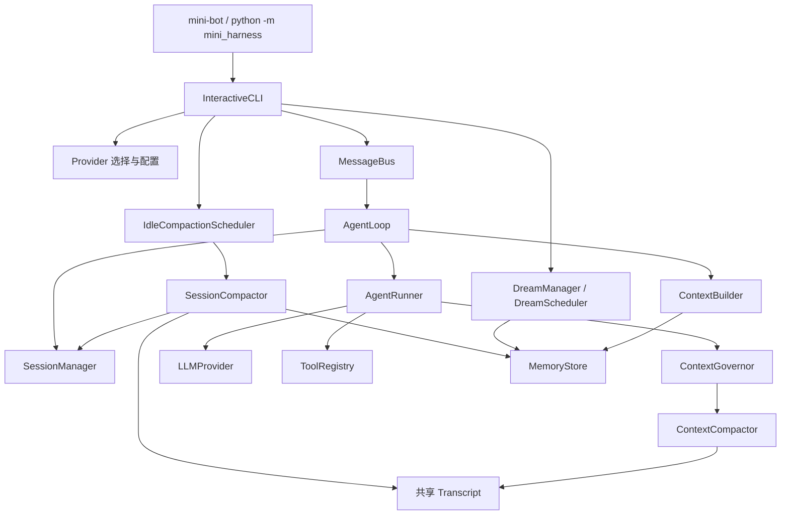

# 当前代码结构与兼容清理结果

核对时间：2026-11-05。以当前工作区源码为准。

功能设计版本为 V2.2；Python 包版本为 `0.3.0`；Session 数据格式为 **schema v2**。三者承担不同职责。

## 1. 当前结构

```text
mini-harness/
├── pyproject.toml
├── uv.lock
├── README.md
├── docs/                         # 结构、设计与 QA 文档
├── mini_harness/
│   ├── __init__.py               # 仅包元数据，避免提前加载所有组件
│   ├── __main__.py               # python -m mini_harness
│   ├── workspace.py              # 路径解析、Workspace 边界与 ID
│   ├── bus/
│   │   ├── events.py
│   │   └── queue.py
│   ├── agent/
│   │   ├── loop.py               # Session / 显式 stateless 消息调度
│   │   ├── runner.py             # 单次模型/工具循环
│   │   ├── context.py            # 上下文组装与历史选择
│   │   ├── context_types.py      # 配置、统计、快照与错误
│   │   ├── tokens.py             # Token 估算与文本截断
│   │   ├── messages.py           # 轮次、工具配对与历史摘要
│   │   ├── governor.py           # 每次请求的预算治理
│   │   ├── compaction.py         # 结构化摘要结果与工具结果截断
│   │   ├── transcript.py         # 两类摘要共享的预算/渲染规则
│   │   ├── session_compaction.py # 持久化摘要与归档补偿
│   │   └── maintenance.py        # Idle Compaction 与失败退避
│   ├── prompts/
│   │   └── defaults.py           # 唯一默认提示词来源
│   ├── session/
│   │   ├── manager.py            # schema v2 严格加载、原子保存与锁
│   │   └── migration.py          # 显式 v1 → v2 迁移与原始备份
│   ├── memory/
│   │   ├── store.py              # 记忆、归档与 cursor 文件 I/O
│   │   ├── document.py           # 文档模型、解析、确定性增删改
│   │   ├── dream.py              # 记忆整理与输入分批/分片
│   │   └── scheduler.py          # Dream 后台调度
│   ├── cli/
│   │   ├── main.py               # 参数、安装入口与离线 demo
│   │   ├── app.py                # 单一 Session 交互与命令调度
│   │   ├── console.py            # 终端与流式渲染
│   │   ├── settings.py           # Provider 选择、推理与模型预算设置
│   │   ├── runtime.py            # 维护命令、组件组装与任务生命周期
│   │   └── profiles.py           # 命名配置持久化
│   ├── providers/
│   │   ├── base.py
│   │   ├── config.py
│   │   ├── presets.py
│   │   ├── factory.py
│   │   ├── openai_compat.py
│   │   ├── anthropic.py
│   │   └── mock.py
│   └── tools/
│       ├── base.py
│       ├── registry.py           # 注册、校验、超时与输出上限
│       ├── examples.py           # AddTool 示例业务工具
│       ├── _file_io.py           # 文件共享原子写入
│       ├── filesystem.py         # ReadFileTool / FileInfoTool / WriteFileTool
│       ├── search.py             # ListDirTool / FindFilesTool / GrepTool
│       ├── edit.py               # EditFileTool / ApplyPatchTool
│       └── command.py            # RunCommandTool
└── tests/                        # 工具、上下文、会话、记忆与 CLI/Provider 测试
```

Tools 继续按文件 I/O、搜索、编辑、命令执行划分；共享写入下沉到 `_file_io.py`。`FindFilesTool` 属于 `search.py`，`ApplyPatchTool` 属于 `edit.py`。

## 2. 运行边界



- `AgentLoop` 管跨轮次状态，`AgentRunner` 管单次任务。正式 CLI 始终走 Session 模式；离线任务显式声明 `stateless=True`，不能同时传入 SessionManager。
- `ContextBuilder` 只组装输入；Token 估算在 `tokens.py`，配置和快照在 `context_types.py`，消息协议在 `messages.py`。
- `ContextGovernor` 管每次请求预算；`ContextCompactor` 只生成请求内摘要，直接返回 `CompactionOutcome`。持久化摘要仍由 `SessionCompactor` 负责，两种生命周期保持分离。
- 两类摘要共享 `transcript.py` 的输入预算与逐条渲染规则，避免持久化 boundary 把未进入摘要输入的消息标记为已归档。
- CLI 配置与维护行为分别在 `ProviderSettingsMixin`、`MemoryMaintenanceMixin` 中组织，均操作同一个 CLI 实例的依赖状态；终端渲染为独立组件，不另建一份会话或配置状态。
- Memory 文档解析/增删改与模型调用、后台调度分开；完整原始消息仍由 Session 保存。

## 3. 本轮已清理的旧接口与重复路径

| 原实现 | 当前统一入口 |
|---|---|
| 根目录 `main.py` 与其中的再导出 | `mini-bot` / `mini-harness` / `python -m mini_harness`，实现为 `cli/main.py` |
| `agent/prompt.py::build_system_prompt()` 及根包/Agent 旧导出 | 默认模板用 `mini_harness.prompts.build_default_system_prompt`；完整上下文用 `ContextBuilder` |
| `session/workspace.py` 与 Session 包中的 Workspace 转导 | `mini_harness.workspace` |
| `SessionManager.session_file/session_path/workspace_path` 别名 | `.path` / `.workspace` |
| `last_request_messages/last_tool_definitions` 重复状态 | 唯一的 `last_provider_request: ProviderRequestSnapshot`；展示与 `/clear` 只使用该快照 |
| CLI 未传 Workspace 时隐式进入 V0 模式、第二套聊天循环 | 默认解析当前工作目录并创建 Session，只有一套正式交互流程 |
| AgentLoop 隐式无 Session 回退 | 显式 `stateless=True`，保留离线 demo；缺 Session 且未声明时直接报错 |
| 摘要器返回列表并写 `last_outcome`，调用方再判断两类返回值 | 始终返回 `CompactionOutcome`，去掉旁路可变结果与兼容分支 |
| `ProviderFactory().create()` 的等价类包装 | 唯一函数入口 `create_provider()` |
| 根包加载所有运行组件 | 根 `__init__.py` 只保留包元数据，公共能力按对应子包导入 |
| Session 运行时读取旧 schema 并补缺省字段 | 正常加载严格接受 schema v2；迁移逻辑独立在 `session/migration.py` |

`AddTool` 已移至 `tools/examples.py`，`registry.py` 只保留工具注册执行基础设施。

之前清理的输出配置旧字段、`tools/patch.py`、`filesystem.py` 中搜索工具转导继续保持移除。没有为上述路径建立新的 shim 或隐式重试旧接口。

## 4. 当前需要保留的能力

以下属于当前运行契约，不按旧版本兼容删除：

- OpenAI-compatible 与 Anthropic 的协议适配，以及 HTTP 字段 `max_tokens/max_completion_tokens`；内部配置继续统一使用 `max_output_tokens`。
- 工具消息简化结构与 OpenAI `function` 结构的识别；它们属于消息协议边界。
- `LLMProvider.chat_stream()` 默认通过 `chat()` 返回完整响应，用于仅实现非流式调用的当前 Provider。Runner 直接使用基类契约，不再单独探测旧对象接口。
- 未知模型容量时的预算默认值、单 profile 自动选择、API Key 缺失时的输入流程。
- 已保存的完整 Session 历史与长期记忆；迁移不会清空或重新摘要历史。

当前库导入示例：

```python
from mini_harness.agent.context import ContextBuilder
from mini_harness.agent.context_types import ContextConfig
from mini_harness.agent.governor import ContextGovernor
from mini_harness.prompts import build_default_system_prompt
from mini_harness.providers import ProviderConfig, create_provider
from mini_harness.tools import ApplyPatchTool, FindFilesTool
from mini_harness.workspace import WorkspaceResolver
```

摘要接口：

```python
outcome = await compactor.compact(messages, budget=budget)
messages = outcome.messages
if outcome.error:
    # messages 保留安全回退副本；调用方决定如何处理失败。
    print(outcome.error)
```

## 5. Session 显式迁移

```bash
mini-bot --migrate-session --workspace /path/to/project
```

- 普通加载只接受整数 `schema_version: 2`，必须含 `summary/summary_boundary/summary_checkpoint_id`。
- 迁移独立执行，持有相同 Session 锁；先校验 Workspace、消息及已有摘要，再以 0600 权限保存原始字节备份 `session.json.v1.bak`，最后原子保存新格式。
- 原始消息、已有摘要、摘要边界与 checkpoint ID 保持不变。早期缺摘要字段的 v1 文件在迁移中补为空值，运行路径不再承担该兼容行为。
- 已是 v2 时验证后返回，不重写文件。备份冲突/软链接、非法历史、运行中 Session、备份失败均拒绝迁移；保存失败保留旧文件与完整备份，可重试。
- 当前项目的本机会话已迁移并核验：**102 条消息完整保留，摘要与边界不变，原始文件有备份**。其他 Workspace 可分别运行同一命令。

## 6. 文件职责收敛与验证

| 文件 | 整理前行数 | 整理后行数 |
|---|---:|---:|
| `cli/app.py` | 1770 | 756 |
| `agent/context.py` | 1317 | 600 |
| `agent/compaction.py` | 1362 | 495 |
| `memory/dream.py` | 913 | 439 |

被提取的实现均移入实际承担职责的新模块，内部导入与测试同时更新。行数减少来自职责拆分和重复分支删除，不代表功能删减。

验证结果：

- 全量 **438 项测试通过**；原有文件工具、预算、Summary、Dream、CLI 设置等功能覆盖保留。
- 新增迁移的备份冲突、失败重试、锁与严格加载测试，以及显式无状态模式约束测试。
- 推理设置分别验证显式 Workspace 和默认 cwd，两组都走同一 Session 实现。
- 全模块导入与全局依赖检查通过；模块入口和已安装的 `mini-bot --demo` 均返回 `结果是 5`。
- 本轮未调用真实模型，也未修改 Provider 的 API Key 或模型配置。
