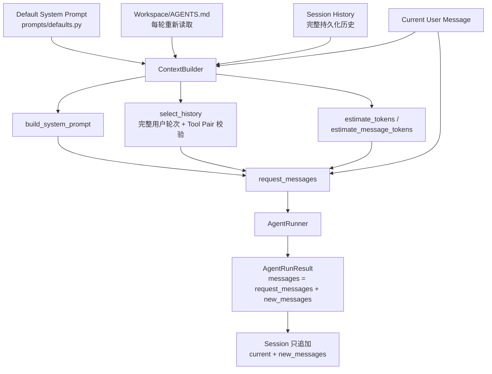

# Context Engineering：Mini Harness V2 源码学习文档

本文记录 Mini Harness V2 的上下文工程实现，并与 [HKUDS/nanobot](https://github.com/HKUDS/nanobot) 的真实源码做对照。文中所有 Mini Harness 结论都能在当前源码中定位；Nanobot 部分注明实际读取的文件与简化边界。

> 适用版本：Mini Harness `0.3.0`（V2）
>
> 核心原则：**Session 负责保存历史，ContextBuilder 负责构建模型输入，AgentRunner 负责执行。三者不能混合职责。**

---

## 1. V1 与 V2 的架构区别

### 1.1 V1 的直接拼接方式

V1 的 `AgentLoop._process_with_session()` 近似如下：

```python
history = session.get_history()          # 实际代码中是 session.messages 的副本
messages = history + [
    {"role": "user", "content": msg.content},
]
request_messages = [
    {"role": "system", "content": build_system_prompt(workspace)},
    *messages,
]
```

随后 `AgentRunResult.messages` 被整体写回 Session。

这种方式在短对话中可用，但存在结构性问题：

1. **没有统一的 System Prompt 构建器**：提示词散落在 AgentLoop / prompt.py，AGENTS.md 无法自动参与。
2. **Session 历史无限增长**：所有历史每轮都发送，超过模型窗口时 Provider 直接报错。
3. **历史中的消息不一定都适合发送**：历史可能包含损坏的工具调用片段、旧版遗留的 system 消息或孤立 tool 结果。
4. **System Prompt 容易进入 Session**：如果直接把 `request_messages` 或 `result.messages` 当作 Session，临时 system 消息会被重复保存，下一轮再拼接一次。
5. **Tool Calling 消息可能被裁断**：简单 `history[-N:]` 可能从 assistant tool_calls 和 tool 结果之间切开，产生非法消息协议。

### 1.2 V2 的职责拆分

V2 把原来由 AgentLoop 顺手完成的“历史 + 当前消息 + 提示词”拆成三个独立边界：

```text
Session.messages（完整、持久化）
        │
        ├───────────────┐
        ▼               ▼
 ContextBuilder     持久化基线
        │               │
        ▼               │
 request_messages      │
（临时、可裁剪）        │
        │               │
        ▼               │
 AgentRunner           │
        │               │
        ▼               │
 本轮 new_messages     │
        │               │
        └──────┬────────┘
               ▼
       新 Session History
```

关键不变量：

- `Session.messages` 永远保存完整历史，不因上下文预算被删除；
- `request_messages` 是临时对象，可以带 System Prompt、可以只含部分历史；
- `AgentRunResult.new_messages` 只包含本轮真正新增的消息，Session 更新只追加它。

---

## 2. ContextBuilder 的核心数据流



`build_messages(history, current_message)` 的最终输出固定为：

```python
[
    {"role": "system", "content": system_prompt},
    *selected_history,
    {"role": "user", "content": current_user_input},
]
```

实现位置：`mini_harness/agent/context.py`。

---

## 3. 源码调用链

以下为当前实际代码的调用链（不是预期结构）：

```text
CLI 读取输入
  → InboundMessage
  → MessageBus.publish_inbound()
  → AgentLoop.run()
  → AgentLoop._process_message()
  → AgentLoop._process_with_session()

  → SessionManager.load()
  → deepcopy(session.messages)

  → ContextBuilder.build_context(history, current_message)
      → ContextBuilder._build_system_prompt_with_status()
          → mini_harness.prompts.defaults.build_default_system_prompt(workspace)
          → ContextBuilder._read_agents_md()
      → estimate_message_tokens({"role": "system", ...})
      → estimate_message_tokens(current_message)
      → ContextBuilder._select_history(history, history_budget)
          → _split_history_into_turns(history)
          → _is_valid_turn(turn)
          → estimate_message_tokens(message)  (逐条累计)
      → 组装 [system, *selected_history, current]
      → 生成 ContextStats 并写 Debug 日志

  → AgentRunner.run(AgentRunSpec(initial_messages=request_messages, ...))
      → AgentRunner._run_core()
          → 记录 input_message_count = len(request_messages)
          → Provider.chat() / chat_stream()
          → 工具调用 → ToolRegistry.execute() → 追加 assistant/tool 消息
          → 最终 assistant 消息
          → AgentRunResult(
                messages=request_messages + new_messages,
                input_message_count=...,
                new_messages=...,
            )

  → AgentLoop 校验 result.messages 的显式边界
  → session.messages = [
        *完整旧 history,
        current_message,
        *new_messages,
    ]
  → SessionManager.save(session)
  → AgentLoop._result_to_outbound()
  → OutboundMessage
  → MessageBus.consume_outbound()
  → CLI 显示回答
```

CLI `/context` 的链：

```text
InteractiveCLI.run()
  → _chat_loop_with_session()
  → InteractiveCLI._print_context()
  → SessionManager.load()
  → ContextBuilder.inspect(session.messages)
      → ContextBuilder.build_context(history, None, check_budget=False)
  → 只打印 ContextStats
  （不保存 Session、不调用 Provider）
```

---

## 4. 关键数据结构

### 4.1 Session.messages

完整、持久化的消息历史。V2 不裁剪它；它可能比模型实际收到的历史长得多。

```python
Session(
    key="cli:main",
    messages=[
        {"role": "user", "content": "第一轮"},
        {"role": "assistant", "content": "第一轮回答"},
        ...
    ],
)
```

### 4.2 selected_history

`ContextBuilder._select_history()` 从 `history` 中选出的**副本**：

- 以完整用户轮次为单位；
- 从最近轮次向旧轮次选择；
- 一旦遇到工具协议不合法或预算不足的轮次就停止；
- 不修改 `Session.messages`。

### 4.3 request_messages

本轮真正发送给 Provider 的消息列表：

```python
[
    {"role": "system", "content": "<默认提示词 + AGENTS.md>"},
    # 可能为空，也可能只包含最近若干完整轮次
    {"role": "user", "content": "旧问题"},
    {"role": "assistant", "content": "旧回答"},
    {"role": "user", "content": "当前问题"},
]
```

它包含临时 System Prompt，可能只包含部分历史，因此**绝不能整体写回 Session**。

### 4.4 AgentRunResult.messages

Runner 的完整返回列表，等于：

```python
request_messages + new_messages
```

其中 `messages[:input_message_count]` 必须与请求时传入的 `initial_messages` 完全一致。

### 4.5 AgentRunResult.new_messages

本轮 Runner 真正新增的消息：

- assistant tool_calls；
- role=tool 的工具结果；
- 最终 assistant 回答；
- 不包含 `request_messages` 的任何消息；
- 不包含 system 消息。

AgentLoop 使用这个字段更新 Session，而不是切片 `result.messages`。

### 4.6 Session History 与 request_messages 对比示例

假设 Session 保存 30 轮、共 60 条消息，预算只允许最近 8 轮：

```text
Session.messages（60 条，完整保留）
  user      第 0 轮问题
  assistant 第 0 轮回答
  ...
  user      第 29 轮问题
  assistant 第 29 轮回答

selected_history（16 条，最近 8 轮）
  user      第 22 轮问题
  assistant 第 22 轮回答
  ...
  user      第 29 轮问题
  assistant 第 29 轮回答

request_messages（18 条）
  system    默认 System Prompt + AGENTS.md
  user      第 22 轮问题
  assistant 第 22 轮回答
  ...
  assistant 第 29 轮回答
  user      当前新问题
```

保存时：

```text
新 Session.messages = 旧 60 条 + 当前新问题 + 本轮 new_messages
```

被裁掉的第 0~21 轮从未从 Session 删除。

---

## 5. 设计原因

### 5.1 为什么 System Prompt 每轮重新构建？

- `AGENTS.md` 可能在两次对话之间被用户修改，每轮读取才能立即生效；
- Workspace 路径与工具集合可能在启动时变化；
- System Prompt 是模型请求的“运行上下文”，不是用户对话内容，不应持久化；
- 如果把 System Prompt 存进 Session，下一轮再构建一次就会出现重复 system 消息，甚至随着轮次增长不断膨胀。

V2 的默认模板集中在 `mini_harness/prompts/defaults.py`，`AgentLoop` / `AgentRunner` 不再各自维护提示词。

### 5.2 为什么 Session History 与 Request Messages 分离？

两者生命周期不同：

| 对象 | 生命周期 | 是否可裁剪 | 是否持久化 |
|---|---|---|---|
| `Session.messages` | 跨轮次、跨进程 | 否 | 是 |
| `selected_history` | 单次构建 | 是 | 否 |
| `request_messages` | 单次请求 | 是（含 System Prompt） | 否 |
| `new_messages` | 单次运行 | 否 | 是（追加） |

如果混在一起，会导致旧历史被裁剪后永久丢失、System Prompt 被重复写入、下一轮上下文重复。

### 5.3 为什么不能直接截取历史最后 N 条？

消息不是独立文本，而是有协议的：

```text
assistant(tool_calls: call_001)
tool(tool_call_id: call_001)
assistant(final answer)
```

`history[-2:]` 可能得到 `[tool(call_001), assistant]`，模型看到孤立 tool 结果；也可能只保留 `assistant(tool_calls)` 而没有 tool 结果。两者都会被 Provider 拒绝，或导致模型行为异常。

V2 的最小裁剪单元是**完整用户轮次**，并对每个轮次验证工具配对。

### 5.4 为什么工具调用消息必须配对？

- OpenAI-compatible / Anthropic 协议都要求 `tool_call_id` 能对应到一个 assistant tool_call；
- 孤立 tool 结果没有可对应的调用，请求非法；
- 缺失结果的 assistant tool_calls 表示一次未完成的工具执行，直接发送会让模型误以为工具已经执行；
- V2 的策略：无法保证合法就丢弃整个轮次，而不是输出半截协议。

### 5.5 为什么上下文预算不应该修改持久化历史？

- 预算取决于当前模型窗口，可能下次换模型或调整配置；
- 删除历史会让“重启后恢复会话”能力失效；
- 用户可能只想暂时使用小模型，不能因此永久丢数据；
- 正确做法：`Session` 保留完整历史，每次请求按当前预算重新选择。

---

## 6. Token 估算与预算

### 6.1 估算公式

`estimate_tokens(text)` 是 V2 的简化估算：

- ASCII 字符：`ceil(ascii_chars / 4)`；
- 非 ASCII 字符：每个字符 1 Token；
- 空字符串为 0。

`estimate_message_tokens(message)` 额外计入：

- 固定消息结构开销 `MESSAGE_OVERHEAD_TOKENS = 4`；
- `role`；
- `content`；
- `tool_calls` 的 JSON 序列化与 `TOOL_CALL_OVERHEAD_TOKENS = 8`；
- `tool_call_id` / `name`。

`estimate_tool_definitions_tokens()` 对传入 Provider 的 Tool Schema 单独估算，因为 Schema 不在 `messages` 中，但会占用真实上下文窗口。

**重要：估算 Token 不等于模型实际 Token 数。** 不同模型的 Tokenizer 不同，工具 Schema、消息格式和特殊 Token 都会造成差异；预算必须同时覆盖输出和估算误差。

V2.2 起预算和 Provider 实际输出参数使用同一个请求计算结果：

```text
C = endpoint/model effective context window
O_max = model max output
I = actual input estimate (messages + tool schema + protocol overhead)
M = safety margin
O_effective = min(O_max, C - I - M)
available_input_tokens = C - O_effective - M
```

`ProviderConfig.context_window_tokens` / `max_output_tokens` 提供模型能力，CLI 可覆盖
新建或已保存的 profile。`max_output_tokens` 是唯一输出配置字段，默认 4096 且
必须为正整数；未知窗口保留教学默认 `8192/1024`。动态 `O_effective` 通过
`provider.set_output_budget()` 设置，由 `provider.output_token_limit` 读取，再由
协议层映射为请求字段；`provider.max_output_tokens` 不随上下文压力改变。

### 6.2 预算分配

```text
available_input_tokens = C - O_effective - M
history_budget_tokens  = available_input_tokens
                         - system_prompt_tokens
                         - current_message_tokens
                         - tool_schema_tokens
```

只有 `history_budget_tokens` 为正数时才选择历史。

### 6.3 实际裁剪实验

在临时 Workspace 中构造 30 轮（60 条）历史，配置：

```python
ContextConfig(max_context_tokens=4096, reserve_output_tokens=512)
```

实际运行结果（来自 `ContextBuilder.build_context()` 的 `ContextStats`）：

```text
System Prompt:            396 estimated tokens
Current Message:           15 estimated tokens
Tool Schema:                0 estimated tokens
Available Input Budget:  3584 estimated tokens
History Budget:          3173 estimated tokens
Session Messages:          60
Selected History Messages: 16
Dropped History Messages:  44
Selected History Tokens:  2912
Estimated Input Tokens:   3323
Selected Roles:           user=8, assistant=8
Request Roles:            system + 8 个完整 user/assistant 轮次 + 当前 user
```

裁剪后的请求从第 22 轮开始，仍是完整用户轮次；第 0~21 轮只是没有发送给模型，Session 的 60 条消息全部保留。

### 6.4 预算不足

如果固定开销已经超过输入预算：

```python
ContextBudgetExceeded(
    estimated_tokens=...,
    available_input_tokens=...,
    breakdown={
        "system_prompt": ...,
        "current_message": ...,
        "tool_schema": ...,
        "safety_margin": ...,
    },
)
```

实际行为：

- `AgentLoop._process_with_session()` 返回 `error="context_budget_exceeded"` 的 `OutboundMessage`；
- CLI 显示清晰错误；
- 不调用 Provider；
- 不修改 Session；
- 不截断当前用户输入。

---

## 7. 历史选择与 Tool Calling 完整性

`_split_history_into_turns()` 按 `role == "user"` 切分历史。任何 user 之前的片段单独成组，并在校验时判为非法。

`_is_valid_turn(turn)` 的规则：

1. 轮次必须以 user 消息开始；
2. assistant 的每个 `tool_calls` 必须有唯一 `id` 和可用 `name`；
3. 紧随其后的 `role=tool` 结果必须覆盖全部声明的 id，且不能重复；
4. 不允许出现无法对应到本轮 `tool_calls` 的 tool 消息；
5. 任意一项不合法 → 整轮丢弃。

选择时从最新轮次向旧轮次遍历：

```python
for turn in reversed(turns):
    if not _is_valid_turn(turn):
        break
    if used_tokens + turn_tokens > history_budget:
        break
    selected_turns.insert(0, turn)
```

因此：

- 选中的历史永远是连续后缀；
- 不会出现“跳过中间轮次”造成的对话空洞；
- 一旦最新轮次自身非法，宁可返回空历史，也不输出非法请求；
- 当前用户消息永远单独追加，不受历史选择影响。

对应测试：

- `tests/test_context_budget.py::test_selection_keeps_tool_call_pairs_intact`
- `tests/test_context_budget.py::test_orphan_tool_message_is_never_selected`
- `tests/test_context_budget.py::test_missing_tool_result_turn_is_dropped`
- `tests/test_context_integration.py::test_tool_call_messages_survive_restart_with_ids`

---

## 8. 与 Nanobot 源码的对应关系

以下基于实际读取的 Nanobot 源码（`main` / `master` 分支的 raw 文件）：

### 8.1 `nanobot/agent/context.py` — ContextBuilder

Nanobot 的真实 `ContextBuilder`：

```python
class ContextBuilder:
    BOOTSTRAP_FILES = ["AGENTS.md", "SOUL.md", "USER.md"]

    def __init__(self, workspace: Path, timezone=None, disabled_skills=None):
        self.workspace = workspace
        self.memory = MemoryStore(workspace)
        self.skills = SkillsLoader(workspace, disabled_skills=...)

    def build_system_prompt(self, *, channel=None, session_summary=None,
                            workspace=None, include_memory=True):
        parts = [self._get_identity(...)]
        bootstrap = self._load_bootstrap_files(root)
        if bootstrap:
            parts.append(bootstrap)
        parts.append(render_template("agent/tool_contract.md"))
        ...
```

真实行为要点：

- System Prompt 按 **identity → bootstrap files → tool_contract → Current Project → memory → Active Skills → Archived Summary** 的顺序拼接，分隔符为 `\n\n---\n\n`；
- `_load_bootstrap_files()` 中 `AGENTS.md` 取 project root，`SOUL.md` / `USER.md` 取 agent workspace；UTF-8 读取、空文件跳过；与内置模板内容相同时跳过；不递归、不读取 memory；
- 使用 `render_template`（Jinja 风格）而不是简单字符串；
- `build_transcript()` 接收 `TranscriptInput(history, current_message, session_summary, runtime_context_blocks, ...)`，产出 `[system, *history, current]` 形式的消息；
- `build_messages()` 只是兼容包装：调用 `build_transcript()` 后合并末尾同 role 消息（`current=None` 不合并）；
- `TranscriptInput.message_count` 明确表示边界消息数量：`1 + len(history) + (current_message is not None)`。

**Mini Harness V2 的简化：**

- 只读取 Workspace 根目录一份 `AGENTS.md`，不实现 SOUL.md / USER.md / Memory / Skills；
- 默认 System Prompt 用 `str` 模板集中维护，不引入 Jinja；
- `build_context(history, current_message)` 对应 Nanobot 的 transcript 构建，但接口更小；
- 不支持图片、runtime context blocks、session summary、skill summary。

### 8.2 `nanobot/session/manager.py` — Session.get_history()

Nanobot 的真实签名是：

```python
Session.get_history(
    max_messages=0,
    *,
    max_tokens=0,
    extend_to_user=False,
    include_runtime_context=True,
)
```

关键行为：

- `replayable = messages[last_archived:]`；`max_messages > 0` 时用 `recent_message_start_index()` 取近窗，`extend_to_user=True` 时向前扩到 user 边界；
- `max_tokens > 0` 时从尾部按 `estimate_message_tokens()` 累加，超预算即停（至少保留最后一条），再对齐到第一个 user，最后调用 `find_legal_message_start()`；
- `find_legal_message_start()` 主要避免历史以**孤立 tool 结果**开头：扫描 assistant `tool_calls` 的 id，遇到未声明的 `tool_call_id` 时把起点移到该 tool 消息之后并清空已声明集合；它不是完整的工具配对校验；
- Loop 的 `_build_turn()` 默认 `max_messages=0` / `max_tokens=0`，即默认全量 replay（受 `last_archived` 限制），只有子 agent 等场景传 `extend_to_user=True`。

**Mini Harness V2 的简化：**

- 不把历史选择放进 `Session.get_history()`，而是放在 `ContextBuilder._select_history()`；
- 用 `_split_history_into_turns()` + `_is_valid_turn()` 实现更严格的“完整用户轮次 + 工具配对”：不仅处理前导孤立 tool，还拒绝缺结果的 assistant tool_calls、重复结果、孤立结果；
- 不做 `max_messages` 与 `max_tokens` 双重限制，只使用 Token 预算；
- 不做隐藏历史、摘要 checkpoint、图片 breadcrumb、`last_archived` 等产品层能力。

### 8.3 `nanobot/agent/context_governance.py` — ContextGovernor

Nanobot 的 ContextGovernance 模块负责：

- `ContextWindowExceededError`：本地预算超限时在请求前抛错；
- `ContextGovernanceConfig` / `input_budget()`：实际公式为 `context_window_tokens - max_output - CONTEXT_SAFETY_BUFFER`；`CONTEXT_SAFETY_BUFFER = 1024`；`max_output` 依次取 `config.max_tokens`、`provider.generation.max_tokens`、4096；`context_window_tokens` 未设置时返回 0，表示不检查；
- `ensure_request_fits()`：请求发送前检查，不裁剪、不丢消息；超预算抛 `ContextWindowExceededError`；只对 pending `read_file` 结果替换为 notice 后重试；
- `prepare_request()`：先规范化/清理 malformed tool_calls、孤立 tool、缺失 tool result，再判断 request pressure；支持 pre-request compaction 和基于 summary checkpoint 的 H/delta compaction。

**Mini Harness V2.1 的简化实现：**

- `ContextGovernor.prepare_request()` 在每次 Provider 请求前检查完整输入预算（System + messages + Tool Schema + safety margin），对应 Nanobot 的 `ensure_request_fits()` 前置检查；
- 硬阈值超限时调用 `ContextCompactor`，用现有 Provider 对已完成的旧历史生成一次结构化摘要；摘要请求自身也先检查预算；
- 摘要失败、摘要不缩小上下文、摘要自身超预算或摘要 + Delta 仍超预算时，安全回退到确定性裁剪：先带元数据截断 Tool Result，再从旧到新丢弃完整轮次，必要时用“完成轮次摘要”保留最近 Assistant 结论；
- `ContextBuilder` 区分完整/未完成轮次；尾部 user-only 空回答轮次不会阻塞更早已完成轮次的结论摘要；
- 预算与 Provider 输出额度共享 `O_effective = min(O_max, C - I - M)`；`reserve_output_tokens`/`safety_margin_tokens` 承担 Nanobot `CONTEXT_SAFETY_BUFFER` 的部分作用；
- 采用 accepted H + unsent Delta：Provider 成功响应后推进 accepted 边界，已发送的当前回合中间 assistant/tool 组可被压缩，尚未发送的最新工具结果原样保留；
- 不实现 Nanobot 的 summary checkpoint 持久化、provider-native compaction、分层记忆；Compact 只改变本轮 Provider 请求，不改变 Session。

### 8.4 `nanobot/agent/runner.py` — AgentRunSpec / AgentRunResult

Nanobot 的 Runner 接收 `AgentRunSpec(initial_messages, tools, runtime, max_iterations, transcript_input, transcript_builder, ...)`，内部通过 ContextGovernor 处理请求压力，返回 `AgentRunResult`。

经核对 `master` 源码：

- Nanobot **没有** `new_messages` 或 `input_message_count` 字段；
- `_run_core()` 内只有局部变量 `request_message_count = len(messages)`，不通过结果返回；
- 保存边界在 `nanobot/agent/loop.py`：`_persist_turn()` 用 `turn_continuation.save_skip_for_turn(...)` 算出 `ctx.save_skip`，`_save_turn(session, ctx.all_messages, save_skip)` 只追加 `messages[skip:]`；
- `TranscriptInput.message_count`（`1 + len(history) + current`）是 Nanobot 的边界来源；普通 user 消息可能在 `_build_turn` 中提前持久化，所以 skip 会相应调整。

**Mini Harness V2 的选择：**

- 保留 V0/V1 的 `_run_core()` 循环基本不变；
- 在 `AgentRunResult` 增加 `input_message_count` 与 `new_messages`，因为 V2 简化版的 AgentLoop 需要一个显式、可验证的“本轮新增消息”边界，不能依赖 `result.messages[len(history):]`；
- `AgentRunResult.messages = initial_messages + new_messages`，但 Session 更新只使用 `new_messages`；这是与 Nanobot 保存边界的教学对照，不是照搬。

### 8.5 `nanobot/templates/agent/identity.md` 与 `tool_contract.md`

Nanobot 的 `identity.md` 包含 Runtime、Workspace、Agent profile（SOUL.md / USER.md）、Memory、Skills、Channel Format Hint、External Content 等模板片段；`tool_contract.md` 描述工具使用契约。

**Mini Harness V2 的简化：**

- `prompts/defaults.py` 中的 `DEFAULT_SYSTEM_PROMPT` 吸收了 Workspace 路径与工具使用规则；
- 不实现身份文件、Channel Format Hint、外部内容安全提示等模板；
- 默认提示词明确要求“不编造工具结果、等待工具返回、如实报告失败、遵守 Workspace 边界”。

### 8.6 Nanobot AgentLoop — `_build_turn` / transcript

Nanobot 的 `AgentLoop` 在 `_build_turn()` 中准备 history、current message 和 transcript，然后交给 Runner。Mini Harness V2 的 `AgentLoop._process_with_session()` 做了同等职责的最小版本：

```text
SessionManager.load()
  → ContextBuilder.build_context()
  → AgentRunner.run()
  → Session 只追加 current + new_messages
  → SessionManager.save()
```

---

## 9. 当前实现的限制（V2 明确不做）

- 不实现 MemoryStore、MEMORY.md、长期记忆提取、RAG；
- 不实现 SkillsLoader、SOUL.md / USER.md 完整身份管理；
- 不实现 summary checkpoint 持久化、分块递归摘要、provider-native compaction、分层记忆；
- 不实现 Hooks、Checkpoint、MCP、多 Channel、多 Session、动态模型切换；
- 不实现独立的上下文重试/恢复机制；
- AGENTS.md 只支持 Workspace 根目录一份，不递归、不合并；
- Token 估算是近似值，不绑定具体模型的 Tokenizer；
- 不做图片、PDF、Office、多模态消息。

---

## 10. 复现实验与测试

```bash
cd mini-harness
uv run pytest -q
```

V2 相关测试：

```text
tests/test_context.py
tests/test_context_budget.py
tests/test_context_integration.py
```

截至本文记录，完整测试结果：

```text
163 passed
```

运行 `/context`：

```text
上下文信息

工作目录：/path/to/project
系统提示词：已加载（571 估算 Token）
AGENTS.md：已加载（83 字符，128 估算 Token）
工具定义：1006 估算 Token
安全余量：0 估算 Token
会话消息数：60
会话角色：assistant=30, user=30
已选历史消息数：10
已丢弃历史消息数：50
已选历史角色：assistant=5, user=5
估算输入 Token：3397
配置输入预算：3584
历史预算：2007
最大上下文 Token：4096（输出预留：512）
```

（以上数字来自一次真实构建：30 轮历史、含 AGENTS.md 和五个文件工具 Schema；会随 Workspace 路径、AGENTS.md、工具集合和历史内容变化，不是硬编码值。`/context` 不包含尚未输入的下一句 current message。）

查看当前进程最近一次真正发给模型的完整请求消息：

```text
/last-prompt
```

该命令读取 `ContextBuilder.last_request_messages` 与 `last_tool_definitions` 的内存快照，不调用 LLM、不保存 Session；进程重启后快照会丢失。`/context` 的预览构建不会覆盖这份“上一次真实请求”快照。Tool 定义不属于 `messages`，而是 Provider 请求的独立 `tools` 参数，所以会在消息列表之后单独打印。
